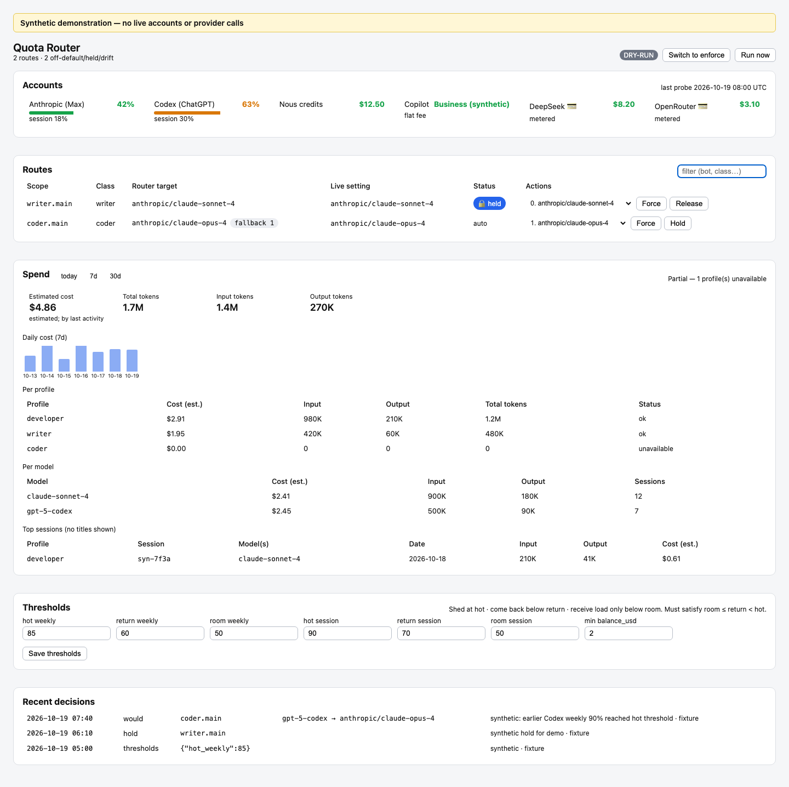

# Hermes Quota Router

[](https://github.com/T0ken2me/hermes-quota-router/actions/workflows/tests.yml)

Policy-driven subscription fallback for [Hermes Agent](https://github.com/NousResearch/hermes-agent).
Monitor provider usage, define which models each profile may use, and inspect proposed switches
before enabling automatic changes. Useful when you run several profiles across subscriptions.

Every 30 minutes a zero-token cron job reads your usage (Claude, ChatGPT/Codex, Nous credit,
optionally Copilot, DeepSeek/OpenRouter balances) and moves each bot's model — main, subagents,
auxiliary tasks, cron jobs — down or back up a per-task ladder:

**subscriptions → Nous credits → flat-fee plan → pay-per-use API (opt-in) → hold**

You control it with `/quota` (CLI, TUI, desktop app, and — if you allow it — chat), from a
**dashboard tab**, or from a **desktop-app page**. All of them drive the same engine.
How it decides: [docs/DESIGN.md](docs/DESIGN.md).

[](docs/images/dashboard.png)

*Actual plugin JavaScript rendered in Chromium with synthetic data and lightweight SDK wrappers.
No live accounts, credentials or provider calls. The fixture theme is not a complete Hermes installation.*

## Requirements and compatibility

- **Plugin:** a Hermes installation with plugin/dashboard SDK support, `hermes` on `PATH`,
  and working logins for the providers in your policy. Model IDs are chosen by you, not discovered here.
- **Platforms:** macOS and Linux. The engine uses POSIX file locking; Windows is not supported.
- **Standalone tests:** Python 3.11–3.14; CI covers those versions on Linux and 3.14 on macOS.
  Tests do not require Hermes or provider credentials.
- **Hermes compatibility:** no minimum Hermes release or full release-by-release integration
  matrix has been established. Private SDK imports and CLI changes can break probes or installation.
  Start in dry-run and check your installed CLI before enabling enforcement.

This is provider-level routing, **not exact account/grant binding, quota reservation or a guarantee
that a task will finish before a limit**. A 30-minute polling interval cannot prevent every 429.
The account-aware prototype is separate from this stable branch.

## Contents

| Path | What |
|---|---|
| `engine/quota_router.py` | The engine (collect → decide → apply). The only implementation. |
| `__init__.py`, `_access.py`, `_engine.py`, `plugin.yaml` | Hermes plugin: `/quota` and who may use it |
| `dashboard/` | Dashboard tab (`dist/`) + backend API (`plugin_api.py`) |
| `desktop/plugin.js` | Desktop-app page, status-bar chip, command-palette entries |
| `scripts/install.sh` | Installer (safe to re-run) |
| `scripts/dashboard_set_password.sh` | Sets the dashboard login (hidden prompt, stores a hash only) |
| `scripts/remote_access.sh` | Puts the dashboard on your tailnet (HTTPS + login) |
| `examples/policy.example.yaml` | Starter policy: ladders, thresholds, routes |
| `tests/` | Ladder, security and API tests (never touch a live install) |

## Install

Requires Hermes with `hermes` on your PATH (macOS or Linux).

```bash
git clone https://github.com/T0ken2me/hermes-quota-router.git
cd hermes-quota-router
bash scripts/install.sh
hermes gateway restart
```

The installer copies the plugin to `~/.hermes/plugins/quota-router`, puts a small launcher in
`~/.hermes/scripts/`, writes a starter policy **in dry-run**, enables the plugin and creates the
half-hourly job. It never overwrites an existing policy and never turns enforcement on.
Change reports go to local files (`~/.hermes/cron/output/`) unless you install with, e.g.,
`QR_DELIVER=telegram bash scripts/install.sh`.

Then:

1. Edit `~/.hermes/workspace/quota-router/policy.yaml`: list your bots' routes under `scopes:`,
   adjust the ladders under `classes:`, and put any private or local-only profile in
   `never_touch`. Optional switches, all **off** by default:
   - `allow_metered: true` — allow pay-per-use API rungs;
   - `control.admins: ["telegram:<your user id>"]` — allow `/quota` from chat;
   - `probes.copilot: true` — read the Copilot plan status (see *Safety notes*);
   - `blocked_providers: [...]` — providers/vendors that must never be routed to (policy
     is refused if a ladder contains one; also matches `vendor/model` ids on aggregators).
2. Watch a few dry-run cycles: `/quota` shows what it *would* switch.
3. Turn it on: `/quota mode enforce`.
4. Desktop app: **Capabilities → Plugins → Rescan**, then enable **Quota Router**.

Update later: `git pull && bash scripts/install.sh`.

## A small policy you can understand

Use this instead of the starter policy for one profile. Replace the uppercase model placeholders
with IDs your Hermes installation supports, and ensure the `coder` profile has the relevant logins.

```yaml
mode: dry_run
allow_metered: false
thresholds:
  hot_weekly: 70
  hot_session: 85
  room_weekly: 50
  room_session: 50
  return_weekly: 55
  return_session: 70
  min_balance_usd: 8
kinds:
  openai-codex: subscription
  anthropic: subscription
  nous: credits
classes:
  coding:
    - [openai-codex, YOUR_CODEX_MODEL]
    - [anthropic, YOUR_CLAUDE_MODEL]
    - [nous, YOUR_NOUS_MODEL]
scopes:
  coder.main: coding
```

With Codex at 75% weekly usage and Anthropic at 20% weekly / 5% session usage,
an unheld route on Codex proposes moving to Anthropic. Once Codex falls below the return
and admission thresholds, it can move back. Missing or malformed subscription windows are
**unknown**, not zero. Nous is eligible only when its reported balance is **strictly above $8**;
at $8 it cannot receive routes. That is an admission reserve, not a hard spending cap on
already-running requests. Metered API rungs remain disabled.

## Using it

```
/quota                        status: accounts, mode, routes off their first choice
/quota routes                 every route with its current model
/quota ladder <route>         the fallback ladder for one route
/quota run                    run a pass now
/quota hold <route> [note]    freeze a route
/quota release <route>        give it back to automatic routing
/quota force <route> <n>      move to rung n now and hold it
/quota mode dry_run|enforce
```

**Who can use it.** The local CLI, TUI and desktop app always can. Over Telegram, Discord, etc.
only the people in `control.admins` can — nobody by default — and changes are refused outside a
private chat with the bot (read-only commands still work in a group).

Routes are named `<bot>.main`, `<bot>.delegation`, `<bot>.aux.<task>`, `<bot>.cron.<job_id>`.
If you change a bot's model by hand, the router notices, tells you once and leaves that route
alone until you `release` it or update the policy.

## Spend panel

The **Spend** section of the dashboard tab shows read-only token and estimated cost data
drawn from Hermes's own `state.db` (the `session_model_usage` table). No re-pricing, no
network calls.

- **Range picker**: today / 7d / 30d.
- **Totals card**: estimated cost, input/output/total tokens, provenance note
  ("estimated; by last activity" — ranges attribute rows by `last_seen`, not exact call time).
- **Daily bar chart**: cost per calendar day (machine timezone).
- **Per-profile table**: cost and tokens broken down by Hermes profile.
- **Per-model table**: top models by estimated cost, token counts, session count.
- **Top sessions**: profile, shortened session ID, model(s), date, tokens, cost —
  **never session titles** (they can contain sensitive information).

Profiles listed in `never_touch` in your policy are completely skipped — their `state.db`
is never opened. Rows where cost provenance is unknown are counted for tokens but their cost
is omitted from the total and flagged in the coverage card.

Attribution notice: `engine/spend.py` is adapted from
[Diabloluo/hermes-hud](https://github.com/Diabloluo/hermes-hud) `dashboard/hud/cost.py`
at `004c18a7`, MIT. See [THIRD_PARTY_NOTICES.md](THIRD_PARTY_NOTICES.md).

## Dashboard login and remote access (optional)

Run `hermes dashboard` and open the **Quota Router** tab; authentication follows your Hermes
dashboard configuration. Do not disable an existing login gate.
To reach it from other devices, use Tailscale — never plain LAN or the internet. The dashboard
shows much more than quotas: chat history, the API-key editor, a terminal.

**1. Set a password.** On the Hermes machine, in a terminal:

```bash
bash scripts/dashboard_set_password.sh
```

It asks for a username and a password (at least 14 characters) at a hidden prompt, stores only a
scrypt hash and a session-signing secret in `~/.hermes/.env` (file mode 600), and never prints
them. Run it again to change the password.

**2. Publish on your tailnet** (macOS; Tailscale installed and logged in):

```bash
bash scripts/remote_access.sh on
```

This keeps the dashboard bound to `127.0.0.1`, starts it as a login item, sets
`dashboard.public_url` so Hermes **refuses to start it without a login**, checks the login is
actually required, and only then turns on Tailscale Serve (tailnet only, not Funnel). It prints the
address, e.g. `https://<machine>.<tailnet>.ts.net`. On Linux, run the dashboard under your own
service manager with `--host 127.0.0.1` and use `tailscale serve` the same way.

**3. Connect.** Open that address from any device on your tailnet and sign in, or in the Hermes
desktop app use **Settings → Gateways → Remote gateway**.

Turn it off: `bash scripts/remote_access.sh off`.
Tip: a Tailscale ACL can limit port 443 on that machine to the devices that should see it.

## Tests

```bash
python3 -m venv .venv
source .venv/bin/activate
python -m pip install -r requirements-test.txt
bash tests/run_all.sh
```

The runner uses the active `python3` (or `HERMES_PY=/absolute/path/to/python`), a temporary
home directory and a stripped environment. The unit harness stubs Hermes bootstrap and CLI
effects; API tests mount the plugin on a test FastAPI app. This proves isolated behavior,
**not live provider authentication or full Hermes integration**. API error-sanitization tests
deliberately log a synthetic internal exception while verifying it is not returned to the caller.

- `test_ladder` — fallback order, hysteresis, unknown readings, pay-per-use opt-in, dry-run.
- `test_security` — policy validation (path traversal, odd model ids), `never_touch`,
  holds/force, `/quota` access control.
- `test_api` — dashboard API: cross-site and form requests refused, rate limits, no error leaks.
- `test_alert` — alert formatter: grouping, icons, budget line, reset times.
- `test_spend` — spend engine: per-profile/model/day aggregations, `never_touch` DB never
  opened, read-only (mtime unchanged), no `title` key anywhere in sessions, day boundaries,
  pricing-unknown rows omitted from totals, limit enforcement.
- `test_quota_boundaries` — missing/invalid percentages, zero usage, recovery eligibility,
  credit reserve boundaries and real decision-path regressions.
- `test_portability` — poisoned-bootstrap subprocess tests: no live Hermes bootstrap is imported.

They use a temporary copy of the example policy with the Hermes CLI fenced off, so they cannot
read or change a real install through their stubbed engine operations. This harness is not an OS sandbox.

### Reproduce the screenshot

```bash
python -m pip install playwright==1.64.0
python -m playwright install chromium
python scripts/capture_demo.py
```

This optional command downloads pinned React/ReactDOM 18.3.1 from jsDelivr and renders the
repository's actual frontend. Browser network requests are blocked, API data is an explicit
fixture, and mutation calls are rejected. It checks headings, route filtering and page errors
before writing `docs/images/dashboard.png`. It does not contact provider accounts.

## Safety notes

- **Routing probes** send usage/balance requests to the provider with the credential Hermes
  holds for that provider. No telemetry. The optional screenshot generator separately downloads
  public React assets from jsDelivr; it does not read accounts.
- Policy/state should contain names and model IDs, not credentials. Provider logins remain in
  Hermes-managed storage; optional dashboard setup writes a password hash and signing secret
  to the protected Hermes environment file. Never commit runtime files or screenshots of real accounts.
- **What it can change:** the model/provider of the routes you list — nothing else — through the
  official `hermes` CLI with validated arguments.
- Profiles in `never_touch` are never read or written.
- An unreadable quota counts as *unknown*: nothing moves because of it.
- Both subscription windows must be finite nonnegative numbers for ordinary admission/recovery.
  Credit balances must also be valid numbers and exceed `min_balance_usd`; an absent threshold
  preserves the legacy positive-balance rule. This does not cap provider-side spending.
- If the current provider is unusable and no destination qualifies, no switch is made; operator
  intervention may be required. The router does not return blindly to an ineligible first rung.
- **Per-profile logins are checked.** Quota is read from one account, but each profile has its own
  logins. Before routing a profile onto a provider, the router asks Hermes, inside that profile,
  whether it can resolve a credential (an expired OAuth token may be refreshed with that
  provider's login server, exactly as Hermes would before a turn; the router only ever sees
  OK / no credential, never a credential value). A definite missing credential excludes that
  destination and triggers a search for an eligible alternative; if none exists the route stays
  configured as-is and may remain unusable. An inconclusive credential check does not block a provider.
  Set `QR_SKIP_CRED_PROBE=1` to turn the check off.
- Pay-per-use APIs only with `allow_metered: true`, only above `min_balance_usd`, flagged 💳.
- The **Copilot probe** calls an undocumented GitHub endpoint (the one editors use) with your
  `gh` login. It is off by default; without it the plan is assumed active.
- The dashboard is the whole Hermes dashboard, not just this tab: never expose it without the
  login and Tailscale.

Found a security problem? See [SECURITY.md](SECURITY.md).

## License

MIT — see [LICENSE](LICENSE). Independent project; not affiliated with Nous Research, Anthropic,
OpenAI or GitHub.
